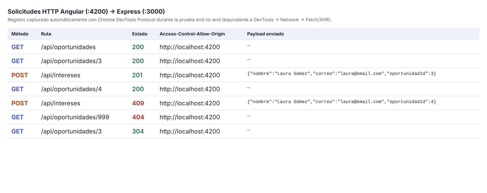
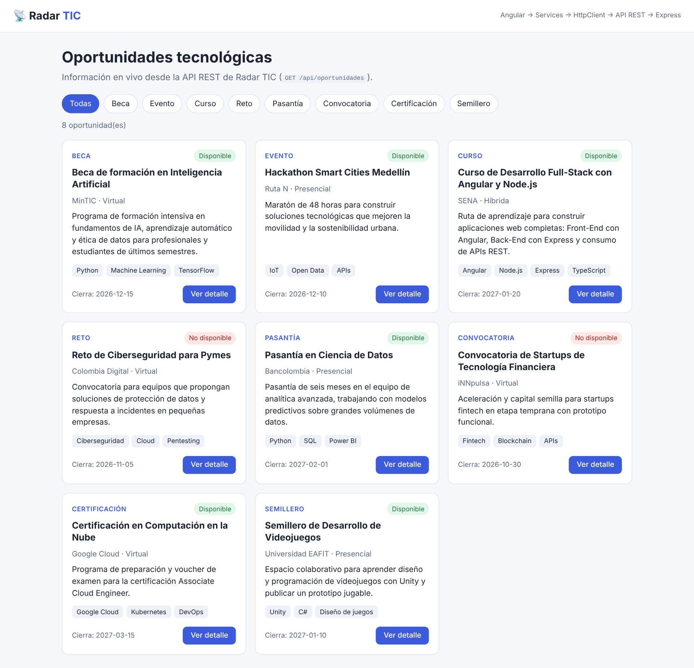
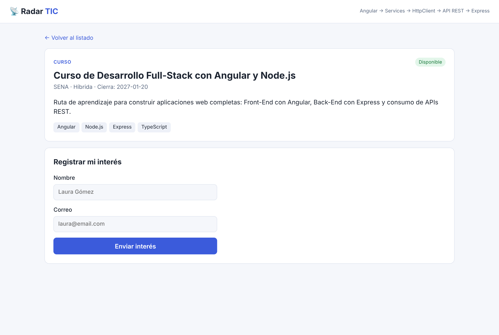
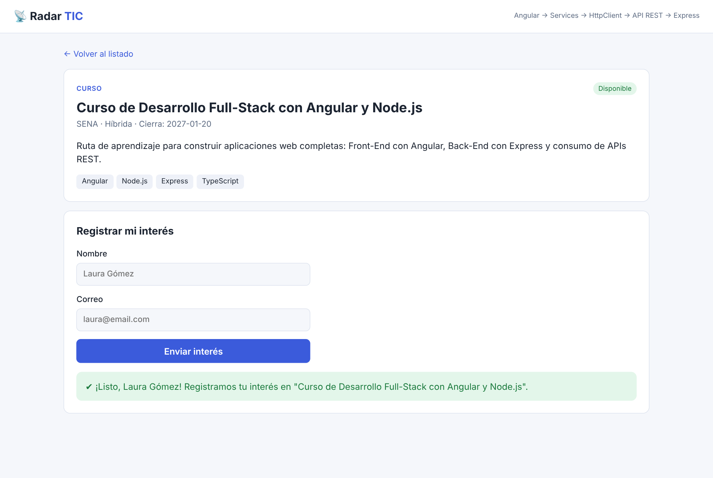
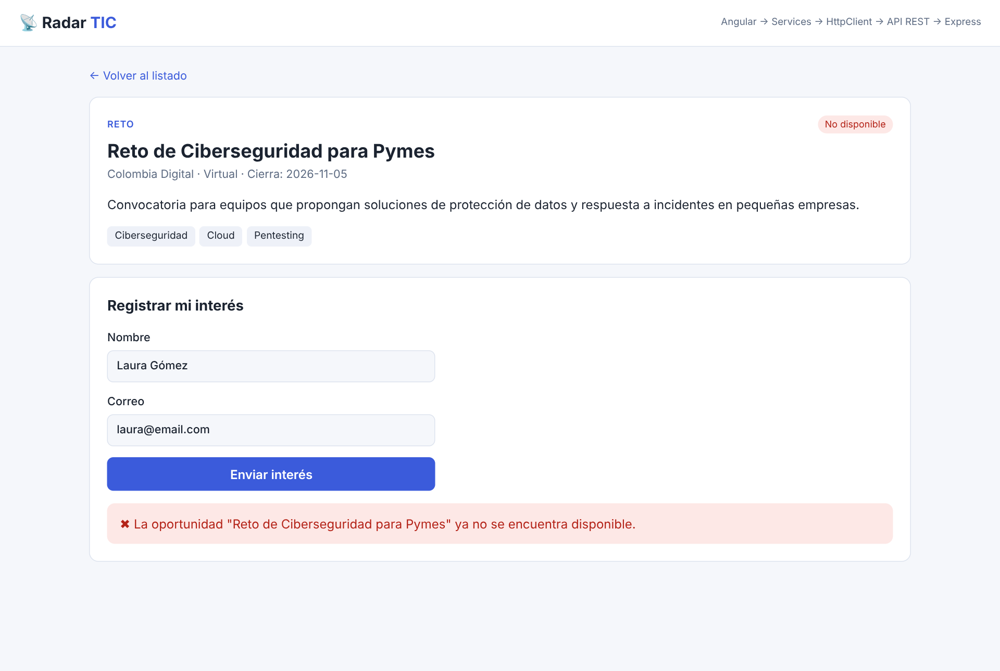
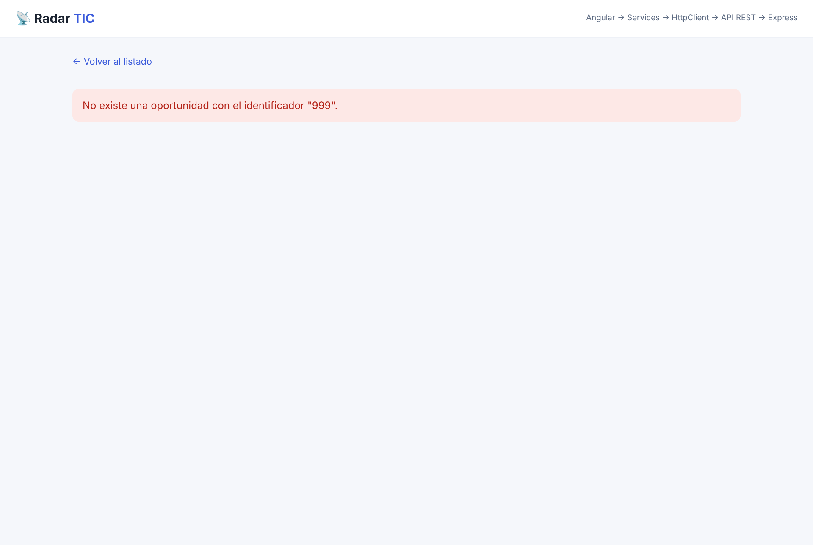
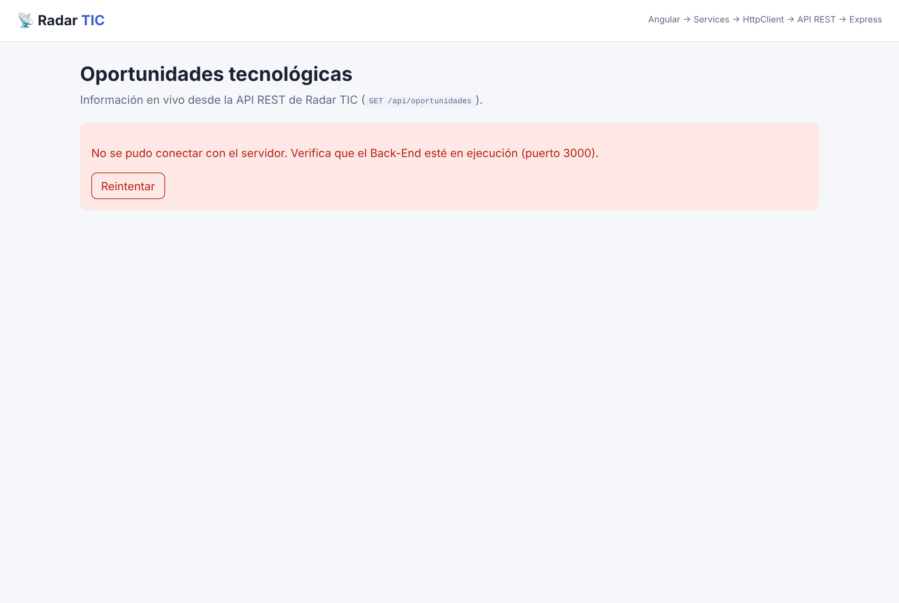

# Informe de entrega — Actividad de Seguimiento 3
## Evolución Full-Stack de Radar TIC

**Repositorio:** `<pega aquí el enlace a tu repositorio>`

---

## 1. Explicación de los cambios respecto a la Actividad de Seguimiento 2

En la Actividad 2, Radar TIC era una aplicación solo de Front-End: Angular leía las oportunidades de un archivo JSON local y no podía enviar información a ningún sitio. En esta actividad se incorporó un **Back-End independiente** con Node.js y Express, de modo que Angular ahora se comunica con él mediante HTTP.

**ANTES**

```
Angular → datos locales
```

**AHORA**

```
Angular → Services → HttpClient → API REST → Node.js + Express
```

| Aspecto | Actividad 2 | Actividad 3 |
|---|---|---|
| Origen de los datos | JSON local dentro de Angular | Servidor Express (`GET /api/oportunidades`) |
| Comunicación | Lectura local | HTTP con `HttpClient`, encapsulado en Services |
| Escritura de información | No existía | `POST /api/intereses` |
| Dónde se valida | Solo en el Front-End | El Back-End es la autoridad final (400 / 404 / 409) |
| Procesos | Uno (Angular, puerto 4200) | Dos independientes (Angular :4200 y Express :3000) |
| Comunicación entre orígenes | No aplica | CORS configurado en Express para `http://localhost:4200` |

**Qué se hizo concretamente**

- **Back-End nuevo (`backend/`):** tres endpoints, validación de datos, CORS y respuestas de error siempre en JSON. Los datos viven en memoria (sin base de datos), tal como lo indica el alcance.
- **Services en Angular:** `OportunidadesService` e `InteresesService` son el único punto de contacto con la API; los componentes no usan `HttpClient` directamente.
- **Se eliminó** la dependencia del JSON local para obtener la colección principal.
- **Dos vistas:** el listado (consume `GET /api/oportunidades`) y el detalle (consume `GET /api/oportunidades/:id` y contiene el formulario que envía `POST /api/intereses`).
- **Manejo de resultados:** el usuario ve el mensaje de éxito o el error que devuelve el servidor, y un mensaje claro si el Back-End no está disponible.

---

## 2. Evidencia de funcionamiento de los endpoints

Resultado de las pruebas mínimas requeridas (verificadas con 16 pruebas automáticas del Back-End y con solicitudes reales):

| Prueba requerida | Resultado |
|---|---|
| `GET /api/oportunidades` retorna la colección | ✅ `200` — 8 oportunidades |
| `GET /api/oportunidades/:id` retorna una oportunidad válida | ✅ `200` — `/api/oportunidades/3` |
| Identificador inexistente produce 404 | ✅ `404` — `/api/oportunidades/999` |
| `POST` con datos correctos es aceptado | ✅ `201` |
| `POST` con campos faltantes es rechazado | ✅ `400` |
| `POST` con oportunidad inexistente es rechazado | ✅ `404` |
| `POST` sobre oportunidad no disponible es rechazado | ✅ `409` |

Validaciones adicionales: correo con formato inválido (`400`), `oportunidadId` que no es un entero (`400`), nombre/correo demasiado largos (`400`), JSON mal formado (`400`) y rutas inexistentes (`404` en JSON).

---

## 3. Evidencia de comunicación entre Angular y Express

Los recorridos siguientes se ejecutaron en un navegador Chromium real con ambos servidores activos (Angular en `:4200`, Express en `:3000`).

### Registro de solicitudes HTTP

Todas las solicitudes pasan de Angular a Express, con el encabezado CORS correcto y el payload del POST:



> Se capturó con Chrome DevTools Protocol, que es la misma fuente de datos de la pestaña *Network → Fetch/XHR*. El `304` de la última fila es normal: el navegador reutilizó una respuesta en caché del servidor (ETag). En DevTools también aparecerá una solicitud `OPTIONS` (*preflight* de CORS) antes de cada `POST`; Express la responde con `204`.

### Angular → GET → Express

El listado se construye con datos recibidos de `GET /api/oportunidades`:



Detalle de una oportunidad (`GET /api/oportunidades/3`):



### Angular → POST → Express

Registro de interés aceptado (`201`) — el mensaje proviene del servidor:



### Errores recibidos desde el servidor y mostrados al usuario

Oportunidad no disponible (`409`):



Identificador inexistente (`404`):



Back-End apagado (la aplicación informa el problema en lugar de quedar en blanco):



---

## 4. Resumen de pruebas

| Nivel | Qué se verificó | Resultado |
|---|---|---|
| Back-End (`cd backend && npm test`) | Endpoints, validaciones, casos límite y CORS | 16 / 16 ✅ |
| Front-End (`cd frontend && npm run test:ci`) | Services (URL, método y payload), componentes, errores del servidor, formulario | 15 / 15 ✅ |
| End-to-end en Chromium | Angular ↔ Express: GET, POST, 201, 409, 404, filtro, formulario inválido, Back-End apagado, CORS, ausencia de JSON local | 15 / 15 ✅ |
